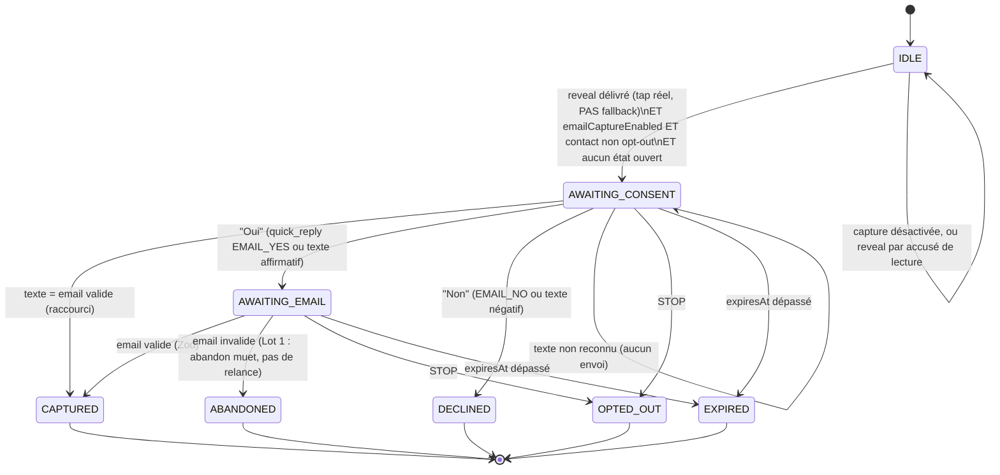

# Capture d'email dans le flux de DM — spécification

Statut : **révision 2, en attente de validation**. Aucun code écrit, aucune migration appliquée.
Base de lecture : `lib/queue/dm-worker.ts` (1290 l.), `lib/meta/webhook.ts`, `lib/meta/client.ts`, `app/api/webhook/route.ts`, `prisma/schema.prisma`.

Révision 2 : intègre les 5 arbitrages, corrige le critère d'éligibilité, supprime l'option C, découpe l'exécution en Lot 1 / Lot 2.

---

## 0. Constats de lecture qui contraignent l'architecture

### 0.1 Le critère d'éligibilité est l'existence d'un point d'ouverture de fenêtre

La fenêtre 24 h s'ouvre quand **la personne nous écrit**. Un commentaire n'est pas un message ; une réponse privée est une exception ponctuelle qui n'ouvre pas de fenêtre. Le code le sait déjà — `dm-worker.ts:407-427` déduplique dessus (« exactly ONE private reply per comment, ever »).

Le critère n'est donc **pas le type de déclencheur** mais la présence d'un point où une action de la personne ouvre la fenêtre :

| Configuration de campagne | Point d'ouverture | Capture |
|---|---|---|
| Commentaire **+ DM d'ouverture à bouton** | le tap = `messaging_postback` | ✅ disponible |
| **Déclencheur DM** (`dmTriggerEnabled`) | le message entrant lui-même | ✅ disponible |
| Commentaire à plat (réponse privée seule) | aucun | ❌ bloquée |

Une campagne commentaire n'est donc pas exclue : elle est éligible dès qu'elle a un DM d'ouverture à bouton. Le blocage ne vise que la réponse privée sèche.

Points d'accroche correspondants, tous deux après `sendRevealDirectMessage` :

- `dm-worker.ts:821` — chemin postback (tap de bouton) → **Lot 1**
- `dm-worker.ts:1127` — chemin DM entrant → **Lot 2**

**Option C (tenter les quick replies dans la réponse privée) : abandonnée.** Comportement non documenté, compte Instagram en garantie. Ne figure ni en fallback ni derrière un flag.

### 0.2 Une quick reply revient en `message`, pas en `postback`

Meta renvoie la réponse à une quick reply comme un **événement message** portant `message.quick_reply.payload`, avec `message.text` = le titre du bouton.

Le type `WebhookEntry.message` (`lib/meta/webhook.ts:68-76`) ne déclare pas `quick_reply` : le payload est aujourd'hui **silencieusement perdu**. Sans lui, un tap sur « Oui » et un « oui » tapé au clavier sont indistinguables.

→ **Premier ticket du Lot 1**, avant toute machine à états.

### 0.3 Une réponse d'email traverserait le matcher de mots-clés

`processMessage` boucle sur les campagnes `dmTriggerEnabled` dès `dm-worker.ts:964`. Une personne en `AWAITING_EMAIL` répondant `marwen@etikks.com` verrait ce texte matché par une campagne en `matchAnyWord` → reveal parasite en plus de la capture.

→ Court-circuit **avant** le `findMany` de la ligne 964.

### 0.4 🔴 Le reveal peut partir sur un accusé de LECTURE, pas seulement sur un tap

Constat nouveau, non identifié en révision 1, et il touche directement le Lot 1.

`app/api/webhook/route.ts:186-228` planifie un job postback avec `fallback: true` **cinq minutes après que la personne a LU le DM d'ouverture sans taper le bouton**. Ce job arrive dans `processPostback` et délivre le reveal par la ligne 821 — le point d'accroche du Lot 1.

Or **une lecture n'ouvre pas la fenêtre 24 h**. Seul un message entrant le fait. Sur ce chemin, le reveal part déjà (comportement existant, hors périmètre), mais un message de capture qui suivrait serait hors fenêtre.

→ **La capture ne démarre que si `fallback !== true`.** Un reveal délivré par accusé de lecture ne déclenche aucune capture. C'est une condition explicite dans le point d'accroche, pas une subtilité à découvrir en production.

### 0.5 Ce qui est déjà correct, à ne pas retoucher

Filtrage d'écho en place et suffisant : `webhook.ts:199` exclut `is_echo` / `is_deleted` / `is_unsupported`, `:210` exclut `senderId === accountId`, mêmes gardes sur postbacks (`:164`) et lectures (`:242`). Déduplication par `dedupeId = "dm:" + messageId` (`dm-worker.ts:981`) et `jobId` base64url (`app/api/webhook/route.ts:178-186`).

La machine à états **réutilise** ces gardes, elle n'en crée pas d'autres.

---

## 1. Schéma Prisma

### 1.1 `Contact`

```prisma
model Contact {
  id          String  @id @default(cuid())
  workspaceId String
  instagramUserId String
  username        String?

  email        String?
  consentedAt  DateTime?
  consentText  String?

  optedOut   Boolean   @default(false)
  optedOutAt DateTime?

  automationId String?

  createdAt DateTime @default(now())
  updatedAt DateTime @updatedAt

  workspace  Workspace   @relation(fields: [workspaceId], references: [id], onDelete: Cascade)
  automation Automation? @relation(fields: [automationId], references: [id], onDelete: SetNull)

  @@unique([workspaceId, instagramUserId])
  @@index([workspaceId, optedOut])
  @@index([workspaceId, email])
}
```

Pas de champ `source` ni d'enum `ContactSource` : aucun chemin d'import n'existe (arbitrage Q5). Retirer une valeur d'enum en Postgres coûte plus cher que d'en ajouter une.

`@@unique([workspaceId, instagramUserId])` porte l'unicité métier **et** l'idempotence : un double webhook produit un `upsert` sans effet.

`optedOut` vit ici et non sur l'état de conversation : la désinscription survit à la conversation et vaut pour **toutes** les campagnes du workspace.

### 1.2 `ConversationState`

```prisma
model ConversationState {
  id          String @id @default(cuid())
  workspaceId String
  instagramAccountId String
  instagramUserId    String
  automationId       String

  state     ConversationStateKind
  expiresAt DateTime
  invalidEmailRetries Int @default(0)   // reste à 0 en Lot 1
  lastMessageId String?

  createdAt DateTime @default(now())
  updatedAt DateTime @updatedAt

  workspace        Workspace        @relation(fields: [workspaceId], references: [id], onDelete: Cascade)
  instagramAccount InstagramAccount @relation(fields: [instagramAccountId], references: [id], onDelete: Cascade)
  automation       Automation       @relation(fields: [automationId], references: [id], onDelete: Cascade)

  @@unique([instagramAccountId, instagramUserId])
  @@index([expiresAt])
  @@index([workspaceId])
}

enum ConversationStateKind {
  AWAITING_CONSENT
  AWAITING_EMAIL
}
```

`@@unique([instagramAccountId, instagramUserId])` : une seule conversation ouverte par personne et par compte, toutes campagnes confondues. Sans elle, deux campagnes qui matchent la même personne ouvrent deux états et elle reçoit deux demandes.

C'est aussi ce qui neutralise le plafond de 5 taps/heure ajouté en `dm-worker.ts:735-751` : cinq taps produisent cinq reveals, mais la deuxième tentative de capture trouve un état ouvert et n'envoie rien.

Une ligne est **supprimée** en fin de parcours (capturé, décliné, stoppé, expiré). Pas d'état terminal conservé : le funnel est tracé ailleurs (§1.4).

### 1.3 État en base plutôt qu'en Redis — validé

L'argument décisif est le mode de panne n°1 du projet : quand Redis tombe, le worker s'arrête en silence. Un état de conversation dans Redis, c'est perdre toutes les captures en vol à chaque incident, sans trace. En base, une coupure gèle le traitement et l'état repart au retour du worker, dans la limite d'`expiresAt`.

Coût accepté : une purge dans un cron existant (§4).

### 1.4 Comptage séparé des DM de capture (arbitrage Q2)

Les messages de capture **consomment** `reserveDMSlot` et `reserveWorkspaceDMSend`, comme tout DM. Mais ils doivent être comptés à part.

**Deux options, la seconde retenue.**

| | Colonne `kind` sur `DmLog` | Table `EmailCaptureEvent` (retenue) |
|---|---|---|
| Invasivité schéma | 1 colonne | 1 table |
| Impact sur l'existant | 🔴 **pollue les métriques** : `dmsSentMonth`, `analytics.sent` et le dénominateur du CTR (`calculateCtr(clicks, dmsSentMonth)`) intègrent toutes les lignes `DmLog`. Ajouter les DM de capture ferait **chuter le CTR artificiellement**, et il faudrait filtrer dans une dizaine d'agrégats existants | aucun — zéro requête existante touchée |
| Mesure du taux de réponse | non, il faut recouper | oui, c'est un funnel |

```prisma
model EmailCaptureEvent {
  id          String @id @default(cuid())
  workspaceId String
  automationId String?
  instagramUserId String
  kind        EmailCaptureEventKind
  createdAt   DateTime @default(now())

  workspace  Workspace   @relation(fields: [workspaceId], references: [id], onDelete: Cascade)
  automation Automation? @relation(fields: [automationId], references: [id], onDelete: SetNull)

  @@index([workspaceId, kind, createdAt])
}

enum EmailCaptureEventKind {
  PROMPT_SENT
  CONSENT_YES
  CONSENT_NO
  EMAIL_CAPTURED
  STOPPED
  EXPIRED
}
```

C'est exactement l'instrument dont le Lot 1 a besoin : `PROMPT_SENT` → `CONSENT_YES` → `EMAIL_CAPTURED` donne le taux de réponse réel, et `PROMPT_SENT + les messages de suite` divisé par `EMAIL_CAPTURED` donne le coût en DM par email collecté.

Le nombre de DM de capture se déduit du funnel : 1 par `PROMPT_SENT`, +1 par `CONSENT_YES` (demande d'adresse, si flux en deux temps), +1 par `EMAIL_CAPTURED` (confirmation), +1 par `STOPPED`.

### 1.5 Champs sur `Automation`

```prisma
  emailCaptureEnabled        Boolean @default(false)
  emailCaptureMessage        String?
  emailCaptureSuccessMessage String?
```

`@default(false)` : les campagnes existantes ne changent pas de comportement, par construction. Aucun backfill.

---

## 2. Texte de consentement (arbitrage Q3)

**Le lien principal part TOUJOURS avant la demande d'email.** Jamais retenu derrière l'adresse. C'est garanti par l'architecture : la capture démarre *après* `sendRevealDirectMessage`, jamais avant, jamais à sa place.

### Texte retenu

> Je t'envoie ça par mail aussi, comme ça tu le retrouves 👌
> Ton adresse ?
>
> *(Tu recevras aussi les prochaines ressources — STOP à tout moment)*

Quick replies attachées : **[Oui, envoie]** · **[Non merci]**

Trois critères vérifiés : le bénéfice est concret (« comme ça tu le retrouves » — un service rendu, pas une contrepartie), il y a **une seule** question, et le STOP est en incise sans alourdir la phrase.

« Space Academy » retiré du texte par défaut : le champ `emailCaptureMessage` est éditable par campagne, et le défaut doit rester neutre pour ne pas nommer une marque dans un produit auto-hébergeable.

### Conséquence : le flux passe de 3 messages à 2

Ton texte demande l'adresse **directement** (« Ton adresse ? ») tout en portant des quick replies oui/non. En révision 1, le flux était en deux temps : question oui/non, puis demande d'adresse. Les deux ne collent pas — une personne qui tape « Oui » se verrait redemander l'adresse dans un second message, pour rien.

Résolution retenue, qui honore ton texte : **l'état `AWAITING_CONSENT` accepte les deux formes de réponse.**

- la personne **tape son email directement** → capturé, `AWAITING_EMAIL` sauté, **un message économisé**
- la personne **tape « Oui »** (quick reply ou texte) → `AWAITING_EMAIL`, on demande l'adresse
- la personne **tape « Non »** → fin

Gain : dans le cas nominal, la capture coûte **2 DM** (demande + confirmation) au lieu de 3. Sur le quota horaire de 750, c'est un tiers de charge en moins par personne captée.

### Confirmation après STOP (arbitrage Q4)

Une ligne, aucun contenu promotionnel, aucune tentative de retenir :

> C'est noté, je ne t'écris plus. 👋

Le STOP coupe **toutes** les campagnes du workspace (`Contact.optedOut`), insensible à la casse, tolérant à la ponctuation et aux espaces : `/^\s*stop\s*[.!?…]*\s*$/i`.

---

## 3. Diagramme d'états — Lot 1



Les états terminaux ne sont pas persistés : la ligne `ConversationState` est supprimée et un `EmailCaptureEvent` est écrit.

### Transitions

| État | Événement | Sortie | Envoi | Événement funnel |
|---|---|---|---|---|
| IDLE | reveal délivré par **tap réel** + capture activée + non opt-out | AWAITING_CONSENT | ✉️ demande + 2 quick replies | `PROMPT_SENT` |
| IDLE | reveal délivré par **accusé de lecture** (`fallback: true`) | IDLE | ❌ | — |
| AWAITING_CONSENT | texte = email valide | CAPTURED | ✉️ confirmation | `CONSENT_YES` + `EMAIL_CAPTURED` |
| AWAITING_CONSENT | `EMAIL_YES` ou {oui, ok, yes, y, o, ouais, d'accord, go, vas-y} | AWAITING_EMAIL | ✉️ « ton adresse ? » | `CONSENT_YES` |
| AWAITING_CONSENT | `EMAIL_NO` ou {non, no, nope, nan} | DECLINED | ❌ | `CONSENT_NO` |
| AWAITING_CONSENT | texte non reconnu | AWAITING_CONSENT | ❌ | — |
| AWAITING_EMAIL | email valide (Zod) | CAPTURED | ✉️ confirmation | `EMAIL_CAPTURED` |
| AWAITING_EMAIL | email invalide | ABANDONED | ❌ **(Lot 1)** | — |
| tout | STOP | OPTED_OUT | ✉️ 1 ligne | `STOPPED` |
| tout | cron, `expiresAt < now()` | EXPIRED | ❌ | `EXPIRED` |

**Idempotence** (piège 2) — trois barrières :
1. `jobId` BullMQ base64url par `messageId` (existant).
2. `ConversationState.lastMessageId` : un `messageId` déjà traité est ignoré, ce qui couvre le cas où BullMQ a purgé le job terminé.
3. `@@unique([workspaceId, instagramUserId])` sur `Contact` : `upsert`, jamais deux lignes.

**Désordre** : une transition ne s'applique que si l'état courant l'autorise. Un consentement arrivant après un STOP ne trouve plus d'état ouvert et ne fait rien.

---

## 4. Fenêtre 24 h et expiration

`expiresAt = now() + 24 h`, posé **à chaque message entrant de la personne**, jamais prolongé par nos envois. Avant tout envoi, le runner vérifie `expiresAt > now()` ; sinon aucun envoi, ligne supprimée, `EXPIRED` écrit.

**Aucun tag `HUMAN_AGENT` nulle part.** `lib/meta/client.ts` n'en contient aucune trace aujourd'hui (vérifié), et n'en contiendra pas.

Purge greffée sur `/api/cron/refresh-tokens` (quotidien 5 h, déjà authentifié par `isAuthorizedCron`) :

```ts
await prisma.conversationState.deleteMany({ where: { expiresAt: { lt: new Date() } } });
```

Pas de nouveau cron : `vercel.json` en compte déjà 3 et le plan Hobby est limité.

---

## 5. Points d'insertion

### Lot 1

| # | Fichier:ligne | Nature |
|---|---|---|
| 1 | `lib/meta/webhook.ts:68-76` | ajouter `quick_reply?: { payload?: string }` à `WebhookEntry.message` |
| 2 | `lib/meta/webhook.ts:188-222` | `parseMessageEvents` propage `quickReplyPayload` |
| 3 | `lib/queue/client.ts` | `ProcessMessageJob` gagne `quickReplyPayload?: string` |
| 4 | `app/api/webhook/route.ts:171-186` | passer le champ dans le job — **`jobId` inchangé** |
| 5 | `lib/meta/client.ts` après `:359` | **nouveau** `sendDirectMessageWithQuickReplies` — `message.quick_replies[{content_type:"text", title ≤ 20, payload}]` |
| 6 | `lib/email-capture/state.ts` | **nouveau** — machine pure sans I/O, testable seule |
| 7 | `lib/email-capture/runner.ts` | **nouveau** — I/O : état, slot, fenêtre, envoi, `Contact`, funnel |
| 8 | `dm-worker.ts:961` début de `processMessage` | **insertion critique** — ordre : ① STOP → ② `handleCaptureReply()` + `return` → ③ boucle existante `:964` |
| 9 | `dm-worker.ts:821` après `sendRevealDirectMessage` | `maybeStartEmailCapture(...)`, **conditionné à `fallback !== true`** (§0.4) |
| 10 | `dm-worker.ts:207` `processComment` | garde opt-out |
| 11 | `dm-worker.ts:686` `processPostback` | garde opt-out |
| 12 | `dm-worker.ts:910` `processFollowUp` | garde opt-out |
| 13 | `app/api/cron/refresh-tokens/route.ts` | purge des états expirés |

Ordre au point 8, celui qui règle §0.3 :

```
processMessage(job)
  ├─ 1. isStopCommand(text) ?            → opt-out global, 1 confirmation, return
  ├─ 2. état ouvert pour (compte, user) ?
  │     ├─ oui → handleCaptureReply()    → consomme le message, return  ← court-circuit
  │     └─ non → continuer
  └─ 3. boucle campagnes existante (ligne 964, inchangée)
```

**Piège 3 (rate limit)** : `runner.ts` est le seul point d'envoi et appelle `reserveDMSlot(account.instagramId)` avant chaque envoi, comme `app/api/instagram/conversations/route.ts:152`. Aucun `sendDirectMessage` direct hors runner. Si `!slot.allowed` : aucun envoi, **état inchangé** — la personne pourra répondre plus tard, dans la limite d'`expiresAt`.

### Lot 2 (à ne pas coder maintenant)

| Fichier:ligne | Nature |
|---|---|
| `dm-worker.ts:1127` | second point d'accroche — chemin déclencheur DM |
| `lib/email-capture/state.ts` | relance unique sur email invalide (`invalidEmailRetries`) |
| — | cas dégradés, gestion fine du quota |
| — | page `/contacts` + export CSV |
| `app/api/dashboard/stats/route.ts` | compteur d'emails captés |

---

## 6. Zod, validation, UI

**Zod** — `app/api/automations/route.ts`, `createAutomationSchema` (~`:38`) et `updateAutomationSchema` (~`:103`) :

```ts
emailCaptureEnabled: z.boolean().optional().default(false),
emailCaptureMessage: z.string().max(900).optional().nullable(),
emailCaptureSuccessMessage: z.string().max(900).optional().nullable(),
```

900 et non 1000 : le texte d'un template Meta est plafonné à 640 caractères et on ajoute la mention STOP.

`refine` de cohérence, sur le modèle de celui du DM d'ouverture (`:75-81`) — **Lot 1** :

```ts
.refine((d) => !d.emailCaptureEnabled || (d.openingDmEnabled && Boolean(d.openingDmButtonLabel?.trim())), {
  message: "Active le DM d'ouverture avec bouton pour capturer les emails",
  path: ["emailCaptureEnabled"],
})
```

En Lot 2, la condition s'élargit à `|| d.dmTriggerEnabled`.

**UI** — `components/campaign-builder.tsx` (1020 l.), bloc calqué sur le follow-up (`:180`, `:288`). Le toggle **guide au lieu d'interdire** : il reste visible et cliquable, mais affiche l'aide « Active le DM d'ouverture avec bouton pour capturer les emails » tant que la condition n'est pas remplie, plutôt que d'être grisé sans explication.

**Validation d'email** (piège 5) — Zod côté serveur, sur le texte reçu :

```ts
const emailSchema = z.string().trim().max(254).email();
```

---

## 7. Ce qui peut casser dans l'existant

| Risque | Mécanisme | Parade |
|---|---|---|
| 🔴 Reveal parasite sur une réponse d'email | matcher de mots-clés `:964` | court-circuit avant le `findMany` (point 8) |
| 🔴 Message hors fenêtre sur accusé de lecture | reveal délivré par `fallback: true` (§0.4) | capture conditionnée à `fallback !== true` |
| 🟠 Interaction avec `followUpEnabled` | après le reveal, `dm-worker.ts:836` planifie déjà un follow-up différé. Capture + follow-up = **jusqu'à 4 DM** pour une personne, et un follow-up dont le délai peut tomber **hors fenêtre** | Lot 1 : ne pas modifier le follow-up, mais **avertir dans l'UI** si les deux sont activés. À mesurer avant d'arbitrer |
| 🟠 Quota horaire | +2 DM par personne captée (2, pas 3, grâce au raccourci §2) | tout passe par `reserveDMSlot` |
| 🟠 Garde opt-out sur `processComment` | nouvelle requête `Contact` par commentaire | index `@@index([workspaceId, optedOut])`. **Change un chemin existant** : une personne opt-out ne reçoit plus de réponse privée — voulu |
| 🟠 Deux campagnes, une personne | deux reveals → deux demandes | `@@unique` sur `ConversationState` |
| 🟠 Taps répétés | plafond de 5/h (`dm-worker.ts:735-751`) → jusqu'à 5 reveals | même `@@unique` : une seule capture |
| 🔵 Métriques du dashboard | intactes : `EmailCaptureEvent` est une table à part, aucune agrégation existante n'est touchée | — |
| 🔵 Tests worker | `__tests__/dm-worker.test.ts` mocke `getRedisConnection` par un `vi.fn()` nu | mocker explicitement `reserveDMSlot` et Prisma, ne pas s'appuyer sur le fail-open |

---

## 8. Estimation par lot

### Lot 1 — premier email en base

| Tâche | h |
|---|---|
| `quick_reply` : type + `parseMessageEvents` + job + route webhook | 1,0 |
| Schéma : `Contact`, `ConversationState`, `EmailCaptureEvent`, champs `Automation`, migration rédigée (non appliquée) | 1,0 |
| `sendDirectMessageWithQuickReplies` + types | 0,75 |
| `state.ts` — machine pure + tests (nominal, raccourci email, STOP, casse, ponctuation) | 1,5 |
| `runner.ts` — état, slot, fenêtre, `Contact`, funnel | 2,0 |
| Câblage worker : court-circuit `:961`, accroche `:821` avec garde `fallback`, 3 gardes opt-out | 2,0 |
| Purge dans le cron existant | 0,25 |
| Zod + `refine` | 0,5 |
| UI : toggle + 2 champs + aide conditionnelle | 1,5 |
| Tests d'intégration : idempotence, désordre, double campagne, opt-out global | 1,5 |
| Recette manuelle sur `marwen.offline` | 0,5 |
| **Total Lot 1** | **12,5 h** |

**Ce n'est pas une journée, c'est une journée et demie.** Je préfère te donner le chiffre que je crois vrai plutôt que de le faire rentrer dans la cible.

Pour atteindre ~8 h, deux coupes possibles, à ton choix :

| Coupe | Gain | Ce qu'on perd |
|---|---|---|
| **Pas d'UI en Lot 1** — activation par `PATCH /api/automations?id=…` en curl sur la seule campagne de test | −1,5 h | rien pour toi (mono-utilisateur), tout pour un tiers |
| **Funnel réduit** à `PROMPT_SENT` / `EMAIL_CAPTURED` | −0,5 h | on mesure le taux de capture global mais plus le décrochage entre consentement et adresse |
| **Tests d'intégration reportés**, tests unitaires de `state.ts` conservés | −1,5 h | filet de sécurité sur les cas concurrents, à rattraper en Lot 2 |

Les trois coupes : **9 h**. Je recommande les deux premières (**10,5 h**) et je garde les tests d'intégration : ce sont eux qui couvrent l'idempotence et le désordre, exactement les pièges que tu as listés.

### Lot 2 — après mesure

| Tâche | h |
|---|---|
| Second point d'accroche (`:1127`, déclencheur DM) + élargissement du `refine` | 1,5 |
| Relance unique sur email invalide | 1,0 |
| Cas dégradés + gestion fine du quota | 2,0 |
| Page `/contacts` + export CSV | 4,0 |
| Compteur d'emails captés au dashboard | 1,0 |
| **Total Lot 2** | **9,5 h** |

---

## 9. Ce que je ne fais pas

Aucun refactor de l'existant. Aucune migration appliquée sans accord explicite. Aucun `.env` ouvert. Pas de page contacts, pas d'export, pas de double opt-in. Le `contactsCount` actuel (`app/api/dashboard/stats/route.ts:144-149`, qui compte des `commenterId` distincts, pas des emails) n'est pas touché. Le filtrage d'écho et la déduplication ne sont pas retouchés — ils sont corrects.

---

## Annexe A — Requête du taux de tap

**Cette requête est la donnée d'entrée qui décide du Lot 1.** Tant qu'elle ne renvoie
pas un volume significatif, le Lot 1 reste non ouvert.

Relevé du 2026-08-04 : `opening_dm_envoyes = 0`, `taps_reels = 0`, `taux_tap_pct = null`.
Aucune campagne n'avait alors `openingDmEnabled` — le mécanisme auquel la capture
s'accroche n'avait jamais servi en production.

Lecture seule. À exécuter dans l'éditeur SQL Vercel (Storage → neon-carmine-forest →
Query, mode Read-only actif). Une seule instruction : l'éditeur refuse plusieurs
commandes dans une même requête préparée.

```sql
WITH opening_sent AS (
  SELECT count(*)::numeric AS n
  FROM "DmLog" l
  JOIN "Automation" a ON a.id = l."automationId"
  WHERE a."openingDmEnabled"
    AND a."openingDmMessage" IS NOT NULL
    AND a."openingDmButtonLabel" IS NOT NULL
    AND l.status = 'SENT'
    AND l."commentId" NOT LIKE 'reveal:%'
    AND l."commentId" NOT LIKE 'dm:%'
),
real_taps AS (
  SELECT count(DISTINCT coalesce(
           m->'postback'->>'mid',
           (m->'sender'->>'id') || ':' || (m->'postback'->>'payload')
         ))::numeric AS n
  FROM "WebhookEvent" w
  CROSS JOIN LATERAL jsonb_array_elements(coalesce(w.payload->'entry','[]'::jsonb))   AS e
  CROSS JOIN LATERAL jsonb_array_elements(coalesce(e->'messaging','[]'::jsonb))       AS m
  WHERE m ? 'postback'
    AND (m->'postback'->>'payload' LIKE 'reveal:%'
      OR m->'postback'->>'payload' LIKE 'followcheck:%')
)
SELECT
  (SELECT n FROM opening_sent) AS opening_dm_envoyes,
  (SELECT n FROM real_taps)    AS taps_reels,
  CASE WHEN (SELECT n FROM opening_sent) = 0 THEN NULL
       ELSE round(100 * (SELECT n FROM real_taps) / (SELECT n FROM opening_sent), 1)
  END AS taux_tap_pct;
```

### Ce que compte chaque terme

**Dénominateur** — les DM d'ouverture réellement délivrés : lignes `DmLog` en `SENT`
issues du chemin commentaire (`commentId` = un vrai id de commentaire, d'où l'exclusion
des préfixes `reveal:` et `dm:`), sur une campagne dont le DM d'ouverture est à la fois
activé **et** complet. Les trois conditions sur `Automation` reproduisent exactement le
test `useOpeningDm` de `dm-worker.ts:532-535` : sans message ni libellé de bouton, le
worker retombe sur la réponse privée à plat et aucun bouton n'est envoyé.

**Numérateur** — les taps réels : postbacks présents dans les payloads webhook reçus de
Meta, filtrés sur les payloads `reveal:` et `followcheck:` que le produit émet. Le
chemin `fallback: true` (déclenché par un accusé de lecture, `app/api/webhook/route.ts:186-228`)
est exclu par construction : il est planifié en interne et ne produit jamais de webhook
entrant. Le `DISTINCT` sur le `mid` absorbe les livraisons multiples de Meta, qui ne
garantit qu'une livraison *au moins* une fois.

### Deux limites à connaître

1. Le dénominateur est évalué avec l'état **courant** de `openingDmEnabled`. Désactiver
   le DM d'ouverture après coup retire rétroactivement ses envois du calcul.
2. Le numérateur dépend de la rétention de `WebhookEvent`, qui n'a aucune purge
   aujourd'hui. Si une purge est ajoutée un jour, l'historique des taps part avec.

### Seuil de significativité : 100 DM d'ouverture délivrés

Au-dessous, ne pas rouvrir le Lot 1.

À n = 100 et un taux observé de 20 %, l'intervalle de confiance à 95 % est d'environ
[12 %, 28 %] — assez serré pour trancher entre « une minorité tape » et « une part
substantielle tape », qui est la seule question à laquelle ce chiffre doit répondre.
À n = 30, le même 20 % donne [6 %, 34 %] : compatible avec les deux conclusions
opposées, donc inutilisable pour décider.
